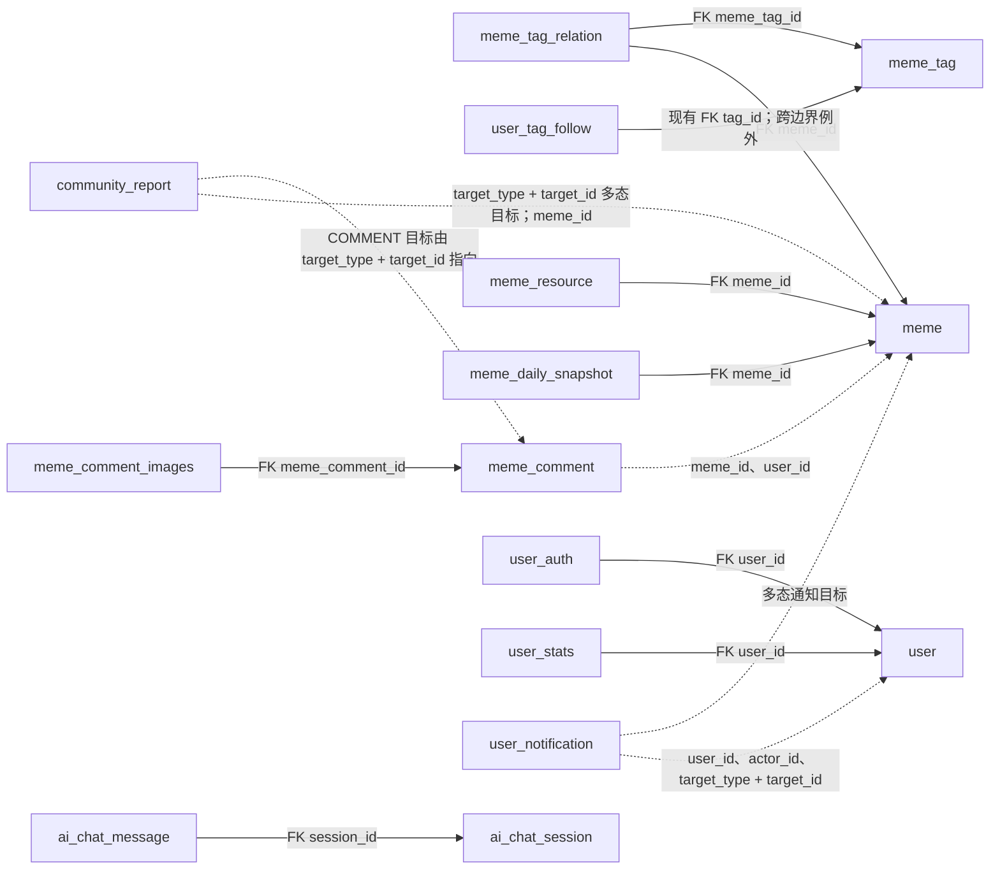

# 数据库表职责与关系说明

本文按用户提供的 DataGrip 表清单整理。当前库已有 `meme_report` 与 `community_report` 两张举报表；执行 `V2026100901` 后，应用统一使用 `community_report`，旧表保留为 `meme_report_archive`。

## 表职责分组

| 业务边界 | 表 | 说明 |
| --- | --- | --- |
| 账号与用户 | `user`、`user_auth`、`user_stats`、`user_stats_orphan_archive` | 用户资料、登录凭据、在线冗余统计及无法关联用户的历史统计归档 |
| 梗内容 | `meme`、`meme_resource`、`meme_tag`、`meme_tag_relation`、`meme_daily_snapshot`、`meme_weekly_topic` | 梗主记录、资源、标签、标签关联、每日趋势快照和周主题 |
| 评论 | `meme_comment`、`meme_comment_images`、`user_comment_like` | 评论树、评论图片、评论点赞状态 |
| 社交互动 | `user_relation`、`user_like`、`user_favorite`、`user_favorite_folder`、`user_tag_follow`、`user_suppression`、`user_notification` | 关注、点赞、收藏、标签关注、屏蔽静音、通知 |
| 内容治理 | `community_report`、`meme_report_archive`、`sensitive_word` | 统一举报队列、旧举报审计归档、敏感词 |
| AI 与运营知识 | `ai_chat_session`、`ai_chat_message`、`admin_knowledge` | AI 会话和消息、运营维护的知识 |
| 平台与迁移 | `home_image`、`flyway_schema_history` | 首页配置、Flyway 迁移记录 |

## 关系类型

实线代表数据库实际外键；虚线代表代码通过 ID 维护的逻辑关系，不由数据库检查目标行是否存在。

`V2026100901` 为 `meme_tag_relation` 两端补充外键，并在物理删除梗或标签时级联清理关系行。`V2026100903` 为资源、每日快照、评论图片、AI 消息、账号凭证和用户统计补充限制删除的外键。若 `user_stats` 有无法关联到 `user.id` 的记录，迁移会先逐字段复制到 `user_stats_orphan_archive`，再从在线统计表移除该孤儿行，避免丢失统计值并确保外键能够建立。`user_tag_follow.tag_id -> meme_tag.id` 是已有真实外键，但跨越用户社交和梗标签边界；以后拆库时应改为应用层校验和事件同步，再移除该外键。其余 `user_id`、`meme_id`、`comment_id`、`target_id` 等是逻辑引用。`community_report` 和 `user_notification` 都有多态目标字段，不能用单个外键覆盖所有目标类型。

运行尚未应用的约束迁移前，可执行只读脚本 [database_preflight.sql](../../just_because_meme_understands_you-backend/src/main/resources/db/database_preflight.sql) 检查孤儿关系和重复状态行。`V2026100903` 会在新增外键前检查五类引用；`user_stats` 孤儿行则先保留到 `user_stats_orphan_archive`，再从在线表移除。已执行的 `V2026100901` 是历史版本，不能修改；它原本会删除无效 `meme_tag_relation` 行，并在有效点赞/收藏与删除态副本并存时删除删除态副本。尚未应用该历史迁移的环境，必须先备份并审阅预检结果。

## 举报数据

`community_report` 是唯一业务读写表。梗举报的 `target_type='MEME'`，`target_id` 和 `meme_id` 都指向梗；评论举报通过 `target_type='COMMENT'`、`target_id` 指向评论，并通过 `meme_id` 保留所属梗上下文。举报对象是逻辑引用，处理队列保留举报提交时的上下文和处理记录。

`meme_report_archive` 只保留迁移前旧梗举报表的历史快照，不能用于新增或更新。迁移把尚未存在于统一队列中的旧记录补入 `community_report`，按 `(target_type, target_id, reporter_user_id)` 判断重复，并为补入记录分配新的主键，避免与评论举报主键冲突。旧表原记录仍完整保存在归档表。

## 冗余计数来源与校准

| 计数字段 | 明细来源与口径 | 当前维护方式和限制 | 校准方式 |
| --- | --- | --- | --- |
| `meme.likes` | `user_like` 中该梗 `is_deleted=0` 的记录数 | 点赞/取消点赞时增减；计数可能因并发或历史写入漂移 | 对账后以有效点赞记录数重算 |
| `meme.comments` | `meme_comment` 中该梗的全部记录数，包含软删除记录 | 评论行与计数在同一数据库事务中写入；删除评论不会扣减，语义是累计评论记录数 | Flyway 校准历史数据；只读对账脚本可持续检查 |
| `meme.page_views` | 当前没有逐次浏览明细表 | 直接递增的运行计数；`meme_daily_snapshot` 是每日快照，不是逐次浏览明细 | 只能保留或依据快照做近似检查，不能从当前明细精确重算 |
| `user_stats.like_received` | 用户名下梗收到的有效 `user_like` 数量 | 点赞和取消时按增量更新 | 对账后按作者聚合有效点赞数重算 |
| `user_stats.favorite_count` | 用户 `user_favorite` 中 `is_deleted=0` 的记录数 | Redis 热计数并异步同步到该列 | 对账后按有效收藏记录数重算，并清理/重建 Redis 热计数 |
| `user_stats.follow_count` / `fans_count` | `user_relation` 中分别以该用户为 `from_user_id` / `to_user_id` 且 `is_deleted=0` 的记录数 | 关注与取消关注时增减 | 对账后按有效关系数重算 |
| `user_favorite_folder.meme_count` | 该收藏夹下 `user_favorite.is_deleted=0` 的记录数 | 收藏、移动和取消收藏时增减 | 对账后按夹内有效收藏行数重算；默认夹以 `folder_id=0` 作为归属值 |

其他保留的冗余计数列已通过迁移设置 `NOT NULL DEFAULT 0`；发布梗数不再存于 `user_stats`，而是使用 `meme(user_id,status,release_time)` 相关索引实时统计。Flyway 会把 `meme.comments` 按全部 `meme_comment` 行校准；运行只读脚本 [database_reconciliation.sql](../../just_because_meme_understands_you-backend/src/main/resources/db/database_reconciliation.sql) 检查其他计数差异。浏览量没有逐次明细，不能精确重算。

## 软删除与唯一性

`user_like` 和 `user_favorite` 使用 `is_deleted=0` 表示有效、`1` 表示已取消。服务在同一行上取消和恢复，因此唯一键改为 `(user_id, meme_id)`，允许每个用户对每个梗最多一条状态记录。历史迁移会在有效行与删除态副本并存时保留有效行、删除删除态副本；只有删除态时保留原行。删除态记录用于快速恢复，不是可审计的操作历史。后续版本已应用后不要回头修改迁移文件；若未应用该历史迁移，先备份并检查预检查询结果。

`user_relation` 原有 `(from_user_id,to_user_id)` 唯一约束已经保证一对用户只有一条关系记录；迁移只移除重复定义的第二个索引。其软删除标记不进入唯一键，因此恢复关注时复用原关系行。

## 微服务拆分提示

当前仍是共享数据库的模块化单体。模块表职责可以作为未来服务边界起点，但只有同服务内关系适合保留外键。拆分时，`user_tag_follow`、收藏/点赞、举报上下文、通知目标等跨服务关系应改用稳定 ID、服务接口或领域事件校验；`user_stats` 等跨模块聚合计数需转为事件投影或查询模型。不要直接把当前逻辑引用误读为数据库外键。
